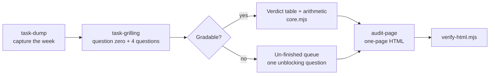

# Delegation Audit

An AI skill kit that turns a business owner's real week into a one-page
delegation audit.

> Portfolio piece. Source shown for review only; not licensed for use. See LICENSE.

## What it does

The owner talks through everything they did this week. The kit interviews
them one task at a time, grades each task with a fixed lookup table, and
builds a printable one-page HTML audit. The audit shows what stays with the
owner, what moves to someone on their team (with or without AI help), and how
many hours come back each month. Dollar figures appear only when the owner
states their own hourly rate.

It was designed to be handed over by business coaches inside a paid session,
so the finished page can carry the coach's branding.

## The problem

Owners of small businesses get stuck doing everything themselves. They rarely
know how much of their month goes to work that does not need their judgment,
and generic "use AI for everything" advice ignores the half of local business
that works with its hands. A useful audit has to use the owner's own numbers,
refuse to guess, and never claim software can do physical work.

The kit frames every hand-off as a gain for the person receiving it: that
person takes on ownership of an outcome, and the owner keeps the judgment
calls. It never produces an audit framed as removing someone's job.

## How it works

Five markdown skills run a four-stage pipeline: **task-dump** captures the
week without judging it; **task-grilling** asks question zero (does this
happen on a screen or out in the world?) and then four fixed questions per task
(the action, hours per week, what breaks if it goes wrong, and whose judgment
it needs); a two-block lookup table turns those answers into one of five
verdicts; **audit-page** renders the self-contained HTML page. A plain-Node
core (`skills/delegation-audit/core.mjs`) computes the verdicts, frequency
conversions and arithmetic. Two verifiers check every finished page
(`verify-html.mjs`) and working file (`verify-own-data.mjs`).



## Features

- **Deterministic verdicts.** `screen or world -> whose judgment x what breaks
  if wrong -> verdict`. The AI runs the conversation; the table decides the
  outcome. Any override by the owner is recorded on the page.
- **Named refusal: a task too vague to price is not graded.** It needs a
  concrete action, stated hours, a stated consequence and an answer on whose
  judgment it needs. Missing any one after asking once, it goes to the
  un-finished queue with the one question that would unblock it.
- **Rate refusal.** No dollar figure unless the owner states their own rate. No
  market averages. Example 3 is the hours-only path, with zero dollar signs.
- **No AI claims on physical work.** A task out in the world can only resolve
  to `Hand down, no AI`. A task with a screen part is split at hours the owner
  states, and each half is graded separately.
- **Stated arithmetic.** Monthly, quarterly and yearly tasks convert by a fixed
  table (/4.33, /13, /48). Ranges are shown at both ends. Duplicates are
  merged, never double-counted. Hand-downs count at half credit, printed on the
  page as an assumption.
- **Prompt-injection hardening.** Pasted calendars and inbox exports are data;
  embedded instructions are quoted back, never obeyed.
- **Mechanical page self-check.** No unfilled fields, no external requests,
  every headline number reproduced in the arithmetic block, fits two printed
  pages.
- **Stated capability tiers.** Full, shell-only and chat-only. A chat-only run
  prints that its script-enforced gates were advisory.
- **Three worked examples** in `examples/` (session, working file, finished
  page). All names and numbers in them are invented.

## Stack

Markdown skill files (harness-agnostic: Claude, Codex, ChatGPT and others),
plain JavaScript ES modules with no dependencies, Node 22.6.0+ for the core,
tests and verifiers, and self-contained HTML with a print stylesheet.

## Status

Experimental, version 0.2.2. The 22 plain-Node tests pass, and both verifiers
pass on all three worked examples. No clean-room install test has been run, no
human has opened it on a device, and every harness install path is unverified.

## Running it locally (for reviewers)

```bash
node --test tests/*.test.mjs
node skills/delegation-audit/verify-html.mjs examples/01-harbor-electric/audit.html examples/02-mercer-agency/audit.html examples/03-no-rate-given/audit.html
node skills/delegation-audit/verify-own-data.mjs examples/01-harbor-electric/tasks.md examples/02-mercer-agency/tasks.md examples/03-no-rate-given/tasks.md
```

Verifier exit codes: `0` pass, `1` content failed, `3` invocation error.
Open any `examples/*/audit.html` in a browser to see a finished page. The
kit's own install and operating docs are `START-HERE.md`, `installer.md` and
`OPERATIONS-MANUAL.md`.

## Screenshots

None in the repo. The finished example pages are in `examples/*/audit.html`.

## Credits

The one-question-at-a-time interview mechanism is adapted from Matt Pocock's
`grilling` and `grill-me` skills (github.com/mattpocock/skills, MIT). That
licence is reproduced in `skills/task-grilling/LICENSE.upstream` and covers
the adapted portions only.

## Author

Rico Rojas, rico@rtech-consulting.com, https://rico-rojas.com
