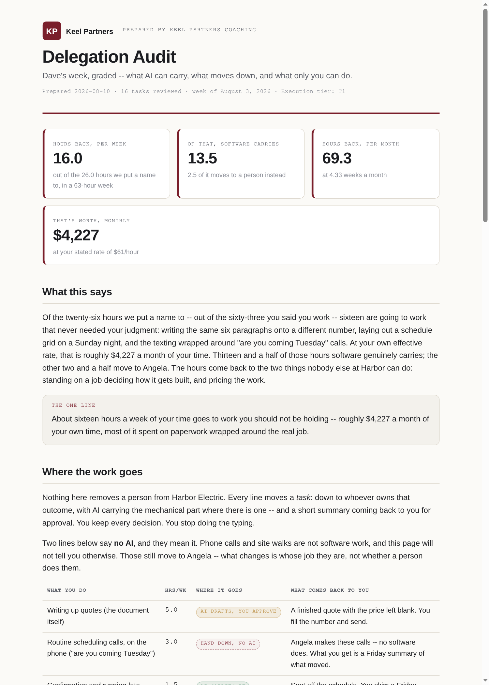
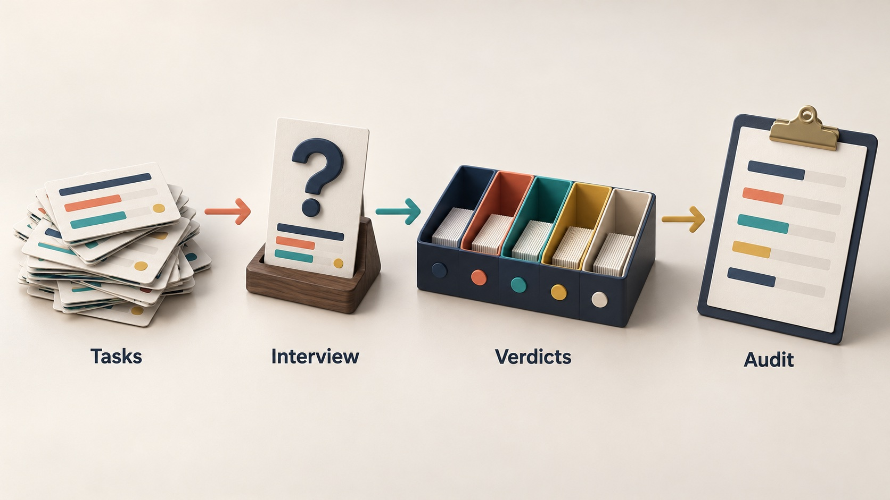
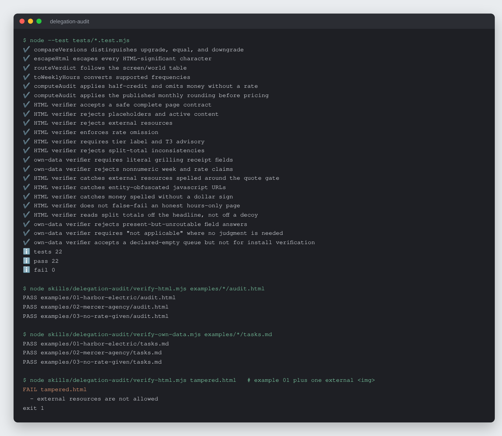

# Delegation Audit

Turn a business owner's real week into a one-page audit of what stays with
them, what moves to their team, and how many hours come back each month.


-f7df1e)


## What it is

An AI skill kit for small-business owners and the coaches who work with them.
The owner talks through everything they did this week. The kit interviews
them one task at a time, grades each task with a fixed lookup table, and
builds a printable one-page HTML audit: what stays with the owner, what moves
to someone on their team (with or without AI help), and how many hours come
back each month. Dollar figures appear only when the owner states their own
hourly rate.

It was designed to be handed over by a business coach inside a paid session,
so the finished page can carry the coach's branding.



*Worked example 1 (`examples/01-harbor-electric/audit.html`), rendered as
shipped. The business and its numbers are invented.*

## Why it exists

Owners of small businesses end up doing everything themselves. They rarely
know how much of their month goes to work that does not need their judgment,
and generic "use AI for everything" advice ignores the half of local business
that works with its hands. A useful audit has to use the owner's own numbers,
refuse to guess, and never claim software can do physical work.

The kit frames every hand-off as a gain for the person receiving it: that
person takes ownership of an outcome and the owner keeps the judgment calls.
It never produces an audit framed as removing someone's job.

## How it works



Five markdown skills run a four-stage pipeline. **task-dump** captures the
week without judging it. **task-grilling** asks question zero (does this
happen on a screen or out in the world?) and then four fixed questions per
task: hours per week, what breaks if it goes wrong, whose judgment it needs,
and who owns the outcome. A two-block lookup table turns those answers into
one of five verdicts, and **audit-page** renders the self-contained HTML page.
A plain-Node core (`skills/delegation-audit/core.mjs`) computes the verdicts,
frequency conversions and arithmetic, and two verifiers check every finished
page (`verify-html.mjs`) and working file (`verify-own-data.mjs`).

## Features

- **Deterministic verdicts.** `screen or world -> whose judgment x what breaks
  if wrong -> verdict`. The AI runs the conversation; the table decides the
  outcome. Any override by the owner is recorded on the page.
- **Named refusal: a task too vague to grade is not graded.** It needs a
  concrete action, stated hours, a stated consequence and an answer on whose
  judgment it needs. Missing any one after asking once, it goes to the
  un-finished queue with the one question that would unblock it.
- **Rate refusal.** No dollar figure unless the owner states their own rate,
  and no market averages. Example 3 is the hours-only path.
- **No AI claims on physical work.** A task out in the world can only resolve
  to `Hand down, no AI`. A task with a screen part is split at hours the owner
  states, and each half is graded separately.
- **Stated arithmetic.** Monthly, quarterly and yearly tasks convert by a
  fixed table (/4.33, /13, /48). Ranges are shown at both ends, duplicates are
  merged, and hand-downs count at half credit, printed on the page as an
  assumption.
- **Pasted data stays data.** Calendars and inbox exports are read as data;
  embedded instructions are quoted back, never followed.
- **Mechanical page check.** No unfilled fields, no external requests, no
  money on an hours-only page, every headline number reproduced in the
  arithmetic block.
- **Stated capability tiers.** Full, shell-only and chat-only. A chat-only run
  prints that its script-enforced gates were advisory.
- **Three worked examples** in `examples/` (an electrical contractor, a
  marketing agency, a solo insurance producer), each with the session, the
  working file and the finished page.

## Run it locally (for review)

Requires Node 22.6 or newer. No packages to install.

```sh
git clone https://github.com/rodaddy/delegation-audit.git
cd delegation-audit

node --test tests/*.test.mjs
node skills/delegation-audit/verify-html.mjs examples/*/audit.html
node skills/delegation-audit/verify-own-data.mjs examples/*/tasks.md

# A finished page opens offline in any browser
open examples/01-harbor-electric/audit.html
```



*The test suite, both verifiers on the three worked examples, then
`verify-html.mjs` on a copy of example 1 with one external `` added.
Verifier exit codes: `0` pass, `1` content failed, `3` invocation error.*

To use the kit itself, open `START-HERE.md` and give `installer.md` to your AI
assistant. `OPERATIONS-MANUAL.md` is the plain-language guide.

**Licence:** free for personal and non-commercial use with credit; commercial
use needs a licence. See [LICENSE](LICENSE) (PolyForm Noncommercial 1.0.0) or
contact rico@rtech-consulting.com.

## Repository layout

- `START-HERE.md`, `installer.md`: the self-adapting installer
- `OPERATIONS-MANUAL.md`: the owner's guide
- `skills/`: `delegation-audit` (conductor, core and verifiers), `task-dump`,
  `task-grilling`, `grill-my-tasks`, `audit-page`
- `examples/`: three complete worked runs
- `tests/`: `node:test` suites for the core and verifiers
- `tiers/`: tier notes
- `docs/`: build story and README images

## How it was built

The kit was built in one day as a re-skin of the Idea Forge interview
pipeline, then hardened through three rounds of simulated-buyer runs, a
hardening pass that moved every mechanical decision into code, and a
cross-model review that found and closed bypasses in its own verifiers. The
full account is in [docs/BUILD-STORY.md](docs/BUILD-STORY.md).

## Project status

Experimental, version 0.2.2. The 22 tests pass and both verifiers pass on all
three worked examples. No clean-room install has been run, no person has used
it on a real week, and every assistant install path is unverified.

## Credits

The one-question-at-a-time interview is adapted from Matt Pocock's `grilling`
and `grill-me` skills (github.com/mattpocock/skills, MIT). That licence is
reproduced in `skills/task-grilling/LICENSE.upstream` and covers the adapted
portions only.

## Author

Rico Rojas, https://rico-rojas.com
